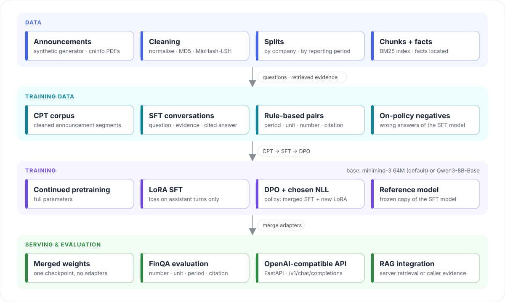

<div align="center">

<picture>
  <source media="(prefers-color-scheme: dark)" srcset="docs/assets/logo-dark.svg">
  
</picture>

<p><strong>Domain adaptation, SFT and preference alignment for financial-announcement QA</strong></p>

<p>
  <a href="LICENSE"></a>
  
  
  
  
  <a href="https://github.com/jingyaogong/minimind"></a>
  
</p>

<p><strong>English</strong> | <a href="README.zh-CN.md">简体中文</a></p>

</div>

## Overview

FinAlign trains a language model to answer questions about listed-company announcements from retrieved evidence. The typical mistake here is not an irrelevant answer but a plausible one: a number from the wrong reporting period, a figure read in the wrong unit, or a citation of a passage that does not support it. FinAlign adapts a pretrained base model to announcements with continued pretraining, teaches it to answer from evidence with LoRA SFT, and aligns it with DPO on preference pairs built around those errors, using a frozen copy of the SFT model as the reference. The adapters are then merged into one checkpoint and served behind an OpenAI-compatible API that a research-report RAG pipeline can call.

- **Announcement data**: an offline generator of fictional companies' periodic reports, earnings forecasts, dividend plans and buyback updates, with structured facts for exact grading; and a cninfo crawler that parses real PDFs into the same format.
- **Cleaning and splits**: MD5 exact and MinHash-LSH near-duplicate removal that also requires the same disclosed figures; companies split into train, dev and test, and reporting periods into history and 2024.
- **Evidence-grounded conversations**: 13,600 multi-turn conversations, each turn with the question, three retrieved chunks (BM25 hard negatives from other periods of the same company) and an answer that states the period, metric, value, unit and citation.
- **Preference pairs around real errors**: rule-based rejected answers with one period, unit, number, citation or unsupported-answer error, each confirmed wrong by the grader, mixed with on-policy negatives sampled from the SFT model; the evidence of each pair is shuffled and its citations renumbered, so the position of a citation carries no preference.
- **DPO that keeps the chosen answer likely**: the policy starts from the merged SFT weights, the reference is a frozen SFT copy (or the same model with its adapters off), and an NLL term on the chosen answer prevents the collapse that plain DPO shows on near-identical pairs.
- **Grading**: numeric accuracy after unit conversion, citation, period, unit and refusal accuracy, with numeric errors traced to evidence from other periods.
- **Two backends**: MiniMind's 64M minimind-3 (Qwen3 architecture), which trains on a laptop CPU, by default; `--backend hf` runs the same stages on a transformers model such as Qwen3-8B-Base.

## Architecture

<p align="center">
  
</p>

| Layer | Stack |
| --- | --- |
| Model | MiniMind minimind-3 (64M, Qwen3 architecture) or any transformers causal LM; LoRA with merging and adapter switching |
| Data | Synthetic announcement generator, cninfo API and pdfplumber, MinHash-LSH, BM25 over character n-grams |
| Training | PyTorch 2.9: continued pretraining, LoRA SFT with assistant-only loss masks, DPO with a frozen or adapter-off reference and a chosen NLL term |
| Evaluation | Rule-based grader shared with data construction, batched greedy decoding |
| Serving | FastAPI, OpenAI-compatible `/v1/chat/completions` with `rag` and `evidence` fields |
| CI | GitHub Actions: pytest, a small data-pipeline run, ruff |

## Quick start

Requirements: Python 3.11 or newer, and Git Bash on Windows for the pipeline script. No GPU is needed for the default model.

```bash
git clone https://github.com/Erikdai/finalign.git && cd finalign
pip install -r requirements.txt
PROFILE=cpu bash scripts/run_pipeline.sh    # about 9 hours on 8 CPU cores
```

The script generates the data, downloads the minimind-3 base checkpoint to `out/pretrain_768.pth`, and runs every stage below. Weights go to `out/`, logs to `logs/`, and each evaluation to `results/<tag>/` (`predictions.jsonl`, `metrics.json`); `results/summary.md` compares SFT with SFT + DPO.

`PROFILE=gpu` trains on all conversations for two epochs. To start from Qwen3-8B-Base instead (transformers 4.51 or later and a GPU):

```bash
BACKEND_ARGS="--backend hf --hf_path /path/to/Qwen3-8B-Base --gradient_checkpointing 1" PROFILE=gpu bash scripts/run_pipeline.sh
```

### Stages

| Script | What it runs |
| --- | --- |
| `data_pipeline/synth_announcements.py` | Fictional announcements with structured facts, plus injected reposts and corrected versions |
| `data_pipeline/crawl_cninfo.py` | Real announcements from cninfo: PDF download, text extraction, key-figures table to rows and facts |
| `data_pipeline/clean_dedup.py` | Normalisation, exact and near-duplicate removal, company and period splits |
| `data_pipeline/build_chunks.py` | Chunks and the location of every fact in them |
| `data_pipeline/build_cpt.py` | Continued-pretraining corpus |
| `data_pipeline/build_qa.py` | SFT, dev and evaluation conversations (`--mode sft`, `dev` or `eval`) |
| `data_pipeline/build_dpo.py` | Rule-based preference pairs |
| `trainer/train_pretrain.py` | Continued pretraining |
| `trainer/train_lora.py` | LoRA SFT |
| `scripts/mine_policy_negatives.py` | On-policy negatives from the SFT model, and the mixed DPO set |
| `trainer/train_dpo.py` | DPO (`--ref_mode copy` or `adapter`, `--sft_alpha` for the chosen NLL term) |
| `evaluation/eval_finqa.py` | Greedy generation and grading |
| `scripts/merge_lora.py` | Merges the adapters into one checkpoint |
| `scripts/compare_results.py` | Markdown table of several evaluations |
| `scripts/serve_openai_api.py` | OpenAI-compatible server |

Every training, evaluation and serving script takes `--backend minimind|hf`, `--hf_path`, `--from_weight` and `--save_dir` (default `out/`).

### Serve and call from a RAG pipeline

```bash
python scripts/serve_openai_api.py --from_weight finalign --loras none --chunks_path data/processed/chunks.jsonl --port 8998
```

```python
from openai import OpenAI
client = OpenAI(base_url="http://127.0.0.1:8998/v1", api_key="none")
question = [{"role": "user", "content": "XX公司2024年第一季度营业收入是多少？"}]
# The server retrieves announcement evidence itself
r = client.chat.completions.create(model="finalign", messages=question, extra_body={"rag": True})
# Or an upstream research-report RAG passes the evidence it retrieved
r = client.chat.completions.create(model="finalign", messages=question, extra_body={
    "evidence": [{"title": "XX公司：2024年第一季度报告", "text": "营业收入（元）：本报告期为..."}]})
print(r.choices[0].message.content, r.model_extra["citations"])
```

In Python, `rag.pipeline.FinRAG(model, tokenizer, chunks_path=...)` does the same: `answer(question, evidence=None, history=())` returns the answer, the cited evidence and the messages.

### Real announcements

```bash
python data_pipeline/crawl_cninfo.py --codes 600519,000858 --categories ndbg,yjdbg --start 2022-01-01 --end 2024-12-31 \
    --out data/raw/cninfo.jsonl --pdf_dir data/raw/pdf
python data_pipeline/clean_dedup.py --in data/raw/cninfo.jsonl --out data/processed/docs.jsonl
```

The output has the generator's row and fact format and goes through the same steps. Keep the request rate low and use the data for research only.

### Tests and evaluation

```bash
pytest -q                                    # unit tests, offline, no trained weights needed
ruff check .
python evaluation/eval_finqa.py --from_weight cpt_fin --loras lora_sft,lora_dpo --tag sft_dpo   # numeric, citation, period, unit and refusal accuracy
python scripts/compare_results.py results/sft results/sft_dpo
```

## Project structure

```
data_pipeline/     announcement generator, cninfo crawler, cleaning and deduplication, conversation and preference-pair builders
dataset/           pretraining, SFT and DPO datasets: ChatML rendering, assistant-only masks, dynamic padding
model/             MiniMind model and tokenizer (upstream), LoRA with merging and adapter switching
trainer/           continued pretraining, LoRA SFT and DPO on the minimind and hf backends
evaluation/        grader and FinQA evaluation
rag/               chunking, BM25 retrieval and the FinRAG pipeline
scripts/           full pipeline, negative mining, adapter merging, serving, result tables
tests/             unit tests
docs/              logo and architecture diagrams
```

## Disclaimer

FinAlign is a research project. The generated announcements describe fictional companies, and nothing the model produces is investment advice.

## Acknowledgements

Built on [MiniMind](https://github.com/jingyaogong/minimind) by Jingyao Gong (Apache-2.0), which provides the model code, the tokenizer, the minimind-3 base checkpoint and the structure of the training scripts. See [NOTICE](NOTICE).

## Author

Dai Cheng Xiao ([@Erikdai](https://github.com/Erikdai))

## License

[Apache License 2.0](LICENSE)
