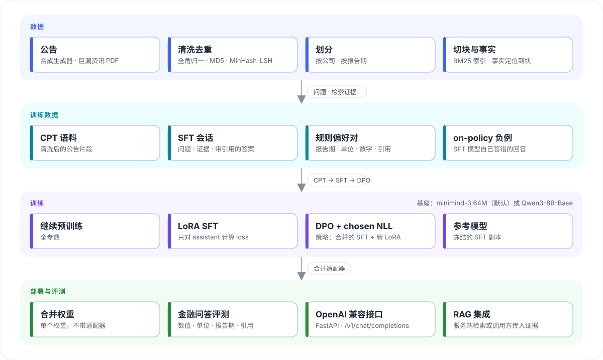

<div align="center">

<picture>
  <source media="(prefers-color-scheme: dark)" srcset="docs/assets/logo-dark.svg">
  
</picture>

<p><strong>FinAlign：面向金融公告问答的领域适配、监督微调与偏好对齐</strong></p>

<p>
  <a href="LICENSE"></a>
  
  
  
  
  <a href="https://github.com/jingyaogong/minimind"></a>
  
</p>

<p><a href="README.md">English</a> | <strong>简体中文</strong></p>

</div>

## 项目简介

FinAlign 训练语言模型依据检索到的证据回答上市公司公告问题。这类场景里典型的错误不是答非所问，而是看似合理的回答：取了其他报告期的数字、读错了单位，或者引用的段落并不支持答案。FinAlign 先在公告语料上做继续预训练完成领域适配，再用 LoRA 监督微调教模型依据证据作答，最后围绕上述错误构造偏好对，以冻结的 SFT 副本为参考模型做 DPO 对齐。适配器合并为单一权重后，以 OpenAI 兼容接口提供服务，可直接接入研报 RAG 流程。

- **公告数据**：离线生成虚构公司的定期报告、业绩预告、利润分配预案与回购进展公告，附带结构化事实，可精确判分；巨潮资讯抓取器把真实 PDF 解析成相同格式。
- **清洗与划分**：MD5 精确去重 + MinHash-LSH 近重复检测，并要求两篇公告披露的数值也一致；按公司划分 train / dev / test，按报告期划分历史期与 2024 年。
- **带证据的多轮会话**：13,600 条多轮会话，每轮包含问题、3 个检索证据块（同公司其他报告期的 BM25 难负例）和注明报告期、指标、数值、单位与引用编号的答案。
- **围绕真实错误的偏好对**：规则构造的 rejected 只含一处报告期、单位、数字、引用或证据不足时编造的错误，并经判分器确认确实答错；再混入从 SFT 模型采样得到的 on-policy 负例；每个偏好对的证据顺序随机打乱、引用编号同步改写，使引用位置本身不带偏好信号。
- **不坍塌的 DPO**：策略模型从合并后的 SFT 权重初始化，参考模型为冻结的 SFT 副本（或关闭适配器的同一模型），并对 chosen 加 NLL 项，避免纯 DPO 在几乎相同的偏好对上出现的坍塌。
- **判分**：单位换算后的数值准确率、引用、报告期、单位与拒答准确率，并把数值错误归因到证据中其他报告期的同名指标。
- **两种后端**：默认使用 MiniMind 的 64M minimind-3（Qwen3 结构），笔记本 CPU 即可训练；`--backend hf` 以同一套流程训练 Qwen3-8B-Base 等 transformers 模型。

## 系统架构

<p align="center">
  
</p>

| 层 | 技术栈 |
| --- | --- |
| 模型 | MiniMind minimind-3（64M，Qwen3 结构）或任意 transformers 因果语言模型；支持合并与开关的 LoRA |
| 数据 | 合成公告生成器、巨潮资讯接口与 pdfplumber、MinHash-LSH、字符 n-gram BM25 |
| 训练 | PyTorch 2.9：继续预训练、只对 assistant 计算 loss 的 LoRA SFT、以冻结副本或关闭适配器为参考并带 chosen NLL 项的 DPO |
| 评测 | 与数据构造共用的规则判分器、批量贪心解码 |
| 服务 | FastAPI，OpenAI 兼容 `/v1/chat/completions`，支持 `rag` 与 `evidence` 字段 |
| CI | GitHub Actions：pytest、小规模数据流程、ruff |

## 快速开始

环境要求：Python 3.11 及以上；Windows 上用 Git Bash 运行流程脚本。默认模型不需要 GPU。

```bash
git clone https://github.com/Erikdai/finalign.git && cd finalign
pip install -r requirements.txt
PROFILE=cpu bash scripts/run_pipeline.sh    # 8 核 CPU 约 9 小时
```

脚本会生成数据、把 minimind-3 基座权重下载到 `out/pretrain_768.pth`，并依次运行下面所有阶段。权重保存在 `out/`，日志在 `logs/`，每次评测写入 `results/<tag>/`（`predictions.jsonl`、`metrics.json`）；`results/summary.md` 对比 SFT 与 SFT + DPO。

`PROFILE=gpu` 在全部会话上训练两轮。若要从 Qwen3-8B-Base 出发（需要 transformers 4.51 及以上和 GPU）：

```bash
BACKEND_ARGS="--backend hf --hf_path /path/to/Qwen3-8B-Base --gradient_checkpointing 1" PROFILE=gpu bash scripts/run_pipeline.sh
```

### 各阶段脚本

| 脚本 | 作用 |
| --- | --- |
| `data_pipeline/synth_announcements.py` | 生成带结构化事实的虚构公告，并注入转载和更正版本 |
| `data_pipeline/crawl_cninfo.py` | 从巨潮资讯抓取真实公告：下载 PDF、抽取文本、把主要财务指标表转成行与事实 |
| `data_pipeline/clean_dedup.py` | 归一化、精确与近重复去重、按公司和报告期划分 |
| `data_pipeline/build_chunks.py` | 切块，并定位每条事实所在的块 |
| `data_pipeline/build_cpt.py` | 继续预训练语料 |
| `data_pipeline/build_qa.py` | SFT、dev 与评测会话（`--mode sft`、`dev` 或 `eval`） |
| `data_pipeline/build_dpo.py` | 规则构造的偏好对 |
| `trainer/train_pretrain.py` | 继续预训练 |
| `trainer/train_lora.py` | LoRA SFT |
| `scripts/mine_policy_negatives.py` | 从 SFT 模型挖掘 on-policy 负例，并生成混合 DPO 数据 |
| `trainer/train_dpo.py` | DPO（`--ref_mode copy` 或 `adapter`，`--sft_alpha` 控制 chosen NLL 项） |
| `evaluation/eval_finqa.py` | 贪心生成并判分 |
| `scripts/merge_lora.py` | 把适配器合并为单一权重 |
| `scripts/compare_results.py` | 多次评测结果的 Markdown 对比表 |
| `scripts/serve_openai_api.py` | OpenAI 兼容服务 |

所有训练、评测和服务脚本都支持 `--backend minimind|hf`、`--hf_path`、`--from_weight` 与 `--save_dir`（默认 `out/`）。

### 部署并接入 RAG 流程

```bash
python scripts/serve_openai_api.py --from_weight finalign --loras none --chunks_path data/processed/chunks.jsonl --port 8998
```

```python
from openai import OpenAI
client = OpenAI(base_url="http://127.0.0.1:8998/v1", api_key="none")
question = [{"role": "user", "content": "XX公司2024年第一季度营业收入是多少？"}]
# 由服务端自行检索公告证据
r = client.chat.completions.create(model="finalign", messages=question, extra_body={"rag": True})
# 或由上游研报 RAG 传入已召回的证据
r = client.chat.completions.create(model="finalign", messages=question, extra_body={
    "evidence": [{"title": "XX公司：2024年第一季度报告", "text": "营业收入（元）：本报告期为..."}]})
print(r.choices[0].message.content, r.model_extra["citations"])
```

在 Python 中也可以直接使用 `rag.pipeline.FinRAG(model, tokenizer, chunks_path=...)`：`answer(question, evidence=None, history=())` 返回回答、被引用的证据和完整消息。

### 真实公告

```bash
python data_pipeline/crawl_cninfo.py --codes 600519,000858 --categories ndbg,yjdbg --start 2022-01-01 --end 2024-12-31 \
    --out data/raw/cninfo.jsonl --pdf_dir data/raw/pdf
python data_pipeline/clean_dedup.py --in data/raw/cninfo.jsonl --out data/processed/docs.jsonl
```

输出与生成器的行格式和事实格式相同，后续步骤一致。请控制抓取频率，仅用于研究。

### 测试与评测

```bash
pytest -q                                    # 单元测试，离线运行，不需要训练好的权重
ruff check .
python evaluation/eval_finqa.py --from_weight cpt_fin --loras lora_sft,lora_dpo --tag sft_dpo   # 数值、引用、报告期、单位与拒答准确率
python scripts/compare_results.py results/sft results/sft_dpo
```

## 目录结构

```
data_pipeline/     公告生成器、巨潮资讯抓取、清洗与去重、会话与偏好对构造
dataset/           预训练、SFT 与 DPO 数据集：ChatML 渲染、只训练 assistant 的掩码、动态 padding
model/             MiniMind 模型与 tokenizer（上游），支持合并与开关的 LoRA
trainer/           继续预训练、LoRA SFT 与 DPO，支持 minimind 与 hf 两种后端
evaluation/        判分器与金融问答评测
rag/               切块、BM25 检索与 FinRAG 流程
scripts/           全流程脚本、负例挖掘、适配器合并、服务、结果对比表
tests/             单元测试
docs/              logo 与架构图
```

## 免责声明

FinAlign 是一个研究项目。生成的公告均为虚构公司，模型输出的任何内容都不构成投资建议。

## 致谢

基于 [MiniMind](https://github.com/jingyaogong/minimind)（作者 Jingyao Gong，Apache-2.0）构建：模型代码、tokenizer、minimind-3 基座权重以及训练脚本的整体结构均来自 MiniMind，详见 [NOTICE](NOTICE)。

## 作者

Dai Cheng Xiao（[@Erikdai](https://github.com/Erikdai)）

## 许可证

[Apache License 2.0](LICENSE)
